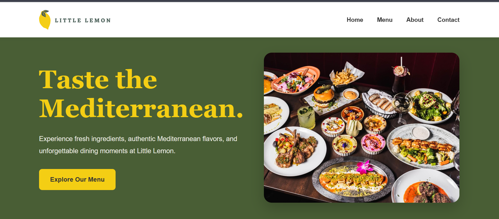

# 🍋 Little Lemon Restaurant Homepage

A modern, responsive restaurant homepage built with **HTML5 and CSS3** as part of the Meta HTML and CSS course graded assessment.

The project represents Little Lemon, a fictional Mediterranean restaurant, with a clean design, welcoming atmosphere, and user-friendly layout.

## 🌐 Live Demo

**Live Website:** [Add your GitHub Pages URL here]

**GitHub Repository:** https://github.com/asfandyarinsights-web/meta-little-lemon-restaurant

## 📸 Project Preview

<!-- Add your homepage screenshot here after uploading it to the repository -->



## ✨ Features

- Responsive design for desktop, tablet, and mobile devices.
- Semantic HTML5 structure for better accessibility and organization.
- CSS Grid for the main content layout.
- Flexbox for navigation and alignment.
- Modern Mediterranean-inspired color palette.
- Interactive navigation links and hover effects.
- Smooth CSS transitions and visual effects.
- Accessible focus states for keyboard navigation.
- Reduced-motion support for accessibility.
- Restaurant promotional banner and featured content cards.

## 🛠️ Technologies Used

| Technology | Purpose |
|---|---|
| HTML5 | Semantic page structure |
| CSS3 | Styling and responsive layouts |
| CSS Grid | Main content and footer layout |
| Flexbox | Navigation and component alignment |
| Media Queries | Responsive design |

## 📁 Project Structure

```text
meta-little-lemon-restaurant/
│
├── index.html
├── style.css
├── README.md
│
└── images/
    ├── logo.png
    ├── hero.jpg
    ├── fresh-food.jpg
    ├── menu.jpg
    ├── restaurant.jpg
    └── homepage-preview.png
```

## 🚀 Getting Started

You can run this project locally without installing any additional dependencies.

1. Clone the repository:

   ```bash
   git clone https://github.com/asfandyarinsights-web/meta-little-lemon-restaurant.git
   ```

2. Navigate to the project directory:

   ```bash
   cd meta-little-lemon-restaurant
   ```

3. Open `index.html` in your browser.

Alternatively, open the project in Visual Studio Code and use the Live Server extension.

## 🎨 Design Approach

The homepage uses a natural Mediterranean-inspired color palette featuring dark green, olive green, lemon yellow, and warm cream.

CSS Grid organizes the hero and featured content sections, while Flexbox provides flexible navigation and alignment.

Responsive breakpoints ensure the layout adapts to different screen sizes. Hover effects, transitions, and visible keyboard focus states improve the overall user experience.

## 📚 What I Learned

Through this project, I practiced:

- Building structured webpages with semantic HTML.
- Styling layouts using CSS Grid and Flexbox.
- Creating responsive designs with media queries.
- Applying CSS pseudo-classes and transitions.
- Organizing reusable styles with CSS variables.
- Improving accessibility and usability.
- Turning a design concept into a functional webpage.

## 🎓 Course Information

**Course:** HTML and CSS in Depth  
**Learning Platform:** Meta / Coursera  
**Assessment:** Little Lemon Restaurant Homepage – Graded Assessment

## 👨‍💻 Author

**Asfandyar Chandio**

BS Information Technology Student | Front-End Development Learner

- GitHub: [@asfandyarinsights-web](https://github.com/asfandyarinsights-web)
- LinkedIn: [Asfandyar Chandio](https://www.linkedin.com/in/asfandyar-chandio-018649388/)

⭐ If you find this project interesting, feel free to explore the repository!